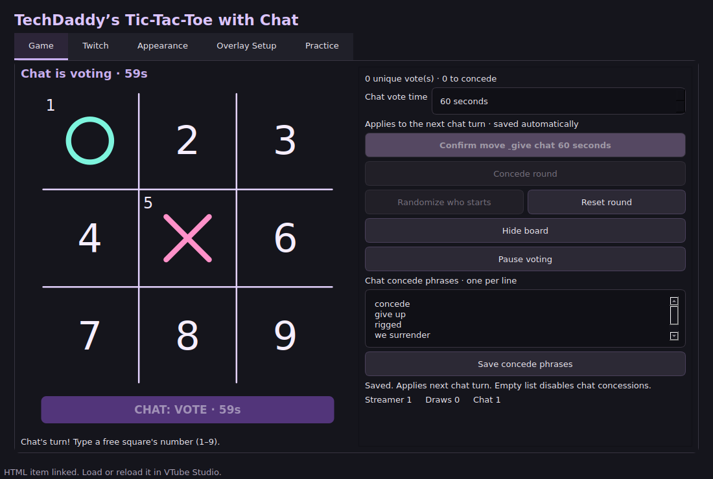
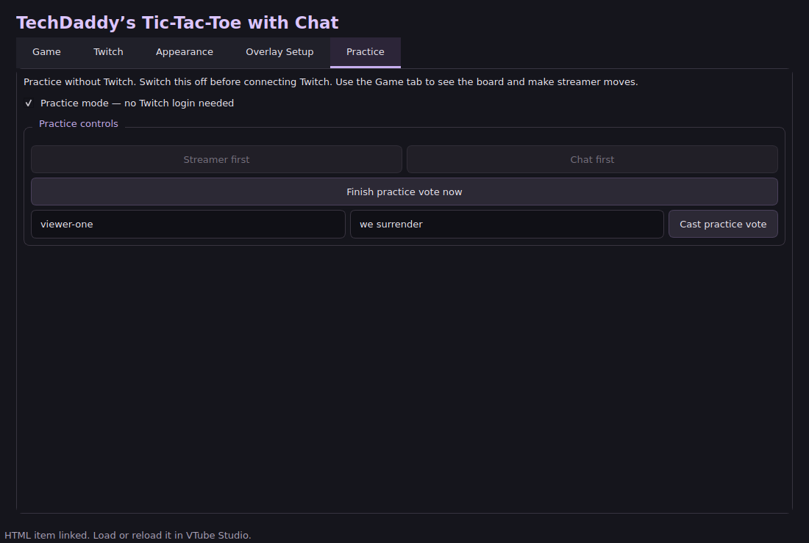
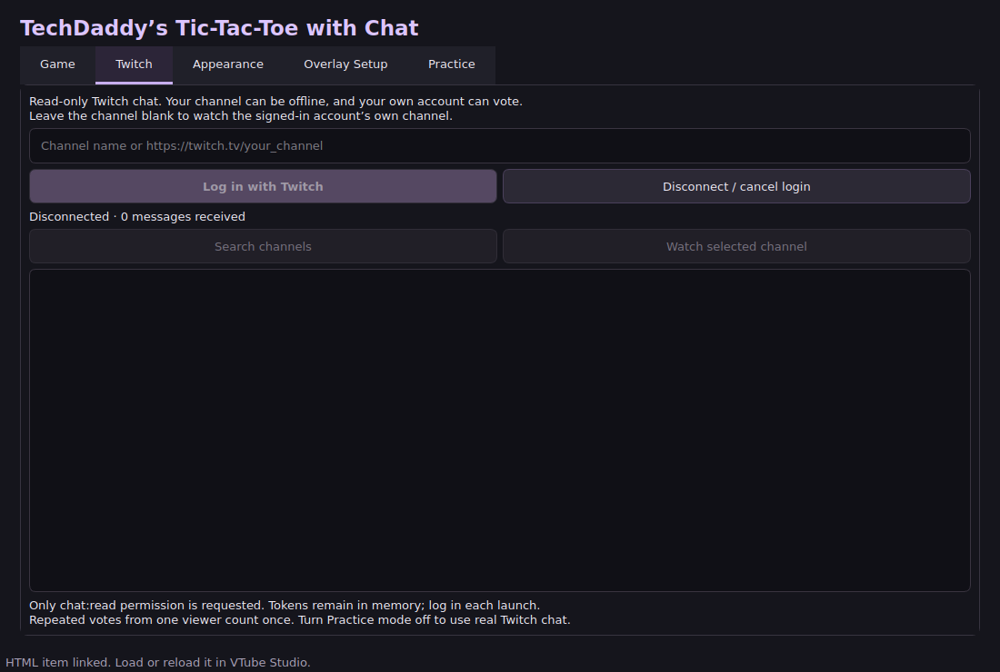
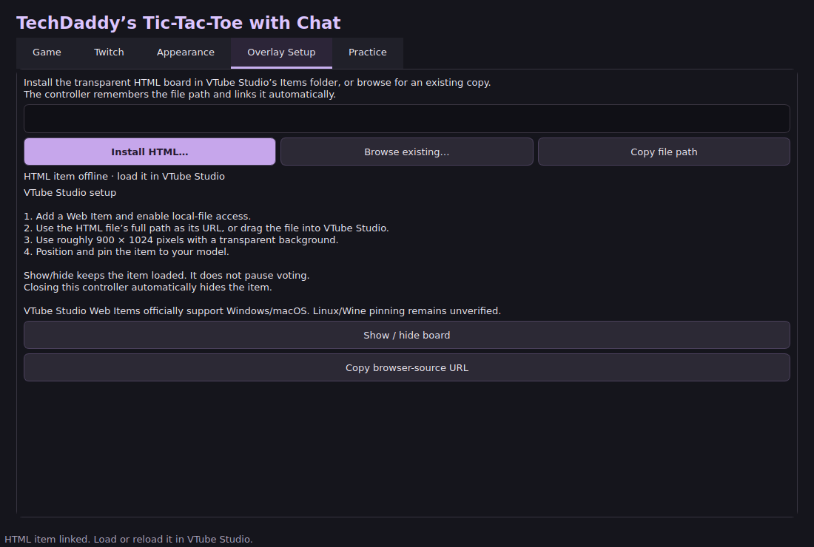
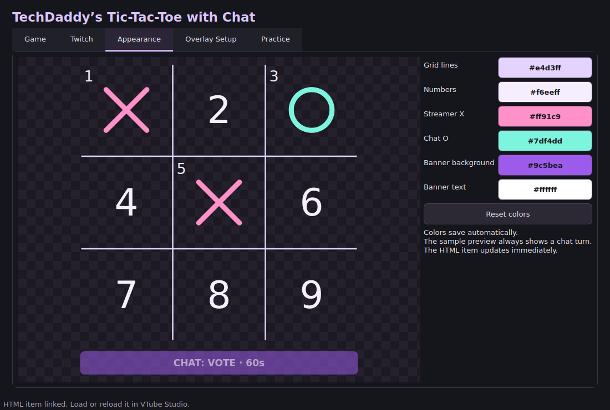

# TechDaddy's Tic-Tac-Toe with Chat — 1.0

Play tic-tac-toe against your Twitch viewers. You click your moves in a desktop window. Your viewers type their votes in Twitch chat. A transparent board can sit beside your VTuber model in VTube Studio.

**[Download version 1.0](https://github.com/TechDaddyKB/TechDaddys-Tic-Tac-Toe-with-Chat/releases/tag/v1.0.0)** · [Help / report a problem](https://github.com/TechDaddyKB/TechDaddys-Tic-Tac-Toe-with-Chat/issues)

You do **not** need to install Python, write code, register a Twitch app, or enter a Client ID. The app is free. Windows and Linux downloads are available. There is no Mac controller download.

## Start here: what are the two pieces?

Think of this as a little board game with a remote control:

- **The controller** is the window you open on your computer. This is where you play, log into Twitch, and change colors.
- **The HTML item** is the board your audience sees. HTML just means “a little web page.” You put that file into VTube Studio and pin it like an item.

Keep the controller open while you play. You and the HTML item need to be on the same computer. Closing the controller makes the audience's board disappear after a few seconds.



The pictures show the real app. The Twitch picture shows the app **before** login. They are controller screenshots, not pictures of a connected VTube Studio model.

## 1. Download and open the app

### Windows

1. Open the **Download version 1.0** link above.
2. Find **Assets** near the bottom. Click it if the file list is folded up.
3. Download **TechDaddyTicTacToe-v1.0.0-Windows-x64.zip**. Choose the Windows ZIP, not “Source code.”
4. Find the ZIP in your Downloads folder. Right-click it and choose **Extract All**. A ZIP is a packed box; extracting unpacks it.
5. Open the unpacked folder. Double-click **TechDaddyTicTacToe.exe**.
6. Keep the file named `_internal` beside the app. It is a folder of parts the app needs. Do not move just the `.exe` onto your desktop. A shortcut is fine.

The app is not code-signed, so Windows may show an unfamiliar-app notice. Check that the download came from the GitHub link above. You can cancel if you are unsure.

### Linux

1. Download **TechDaddyTicTacToe-v1.0.0-Linux-x64.zip** from the same release page.
2. Right-click the ZIP and choose your file manager's **Extract** option.
3. Open the extracted folder. Find **TechDaddyTicTacToe**.
4. If double-clicking does not open it, right-click that file, open **Properties**, and allow it to run as a program. Your desktop may call this **Executable** or **Allow executing file as program**.
5. Open it again. Keep its `_internal` folder beside it.

If your desktop requires a terminal, open a terminal in the extracted folder and run:

```bash
chmod +x TechDaddyTicTacToe
./TechDaddyTicTacToe
```

The Linux build is for x86_64 computers, such as ordinary Intel/AMD PCs. It requires a graphical Linux desktop. It is not an ARM/Raspberry Pi build. The Linux controller has been reported working by the project owner; VTube Studio's official Web Item documentation covers Windows/macOS, so running VTS through Wine is a separate setup.

### Updating from an older version

Close the old app first. Extract the new download into a **new folder**, then open the new app. Your saved channel, colors, board visibility, vote time, and linked HTML file carry over automatically. Older settings get the default concede phrases. You do not need to copy a settings file yourself.

## 2. Try a practice round first — no Twitch login needed

This is optional, but it is a quick way to learn the buttons.

1. Open the **Practice** tab.
2. Turn on **Practice mode**. Twitch must be disconnected first.
3. Click **Streamer first** or **Chat first**.
4. Open the **Game** tab to see the board. When it is your turn, click an empty square and then **Confirm move & give chat … seconds**.
5. For a pretend chat vote, return to **Practice**. Leave the viewer name as `viewer-one`, type a number, and click **Cast practice vote**.
6. Click **Finish practice vote now** to see the result immediately. Otherwise the usual timer runs.
7. Change the viewer name to `viewer-two` to pretend to be a second person. Clicking repeatedly with the same name still counts as one vote.
8. You can also enter a concede phrase here to try a chat concession.
9. Before using real Twitch chat, reset the round, switch **Practice mode off**, then open the **Twitch** tab.

Practice controls live in their own tab. The Game screen and audience board do not show “TEST MODE” wording. Practice rounds still use the board, overlay, and session scores; reset the round before switching modes.



## 3. Connect your Twitch chat



1. Click the **Twitch** tab.
2. Enter your channel name, such as `your_channel`, or paste your full channel link, such as `https://twitch.tv/your_channel`.
3. Or leave the box empty to use the channel belonging to the account you log into.
4. Click **Log in with Twitch**.
5. Your browser opens Twitch's authorization page. The app also shows a code and a link. Follow Twitch's instructions and enter the displayed code if Twitch asks for it.
6. Approve the request to **read chat**. The app cannot post messages to your chat.
7. Return to the controller. Wait for its status to say **Chat connected**.

You will log in again each time you open the controller. Your Twitch login tokens are kept in memory, not saved in your settings file.

**You can try this while your stream is offline.** Twitch chat still works. Open your own Twitch chat, start a chat turn, and send a number. Your own account's messages count too.

### Find or change a channel

After login, enter a name and click **Search channels**. Click a result, then **Watch selected channel**. You can also paste a channel link directly and click **Watch selected channel**. If a channel is missing from search results, try its direct link.

Finish or reset the current round before changing channels. This keeps two different audiences from sharing one round.

The received-message count tells you that messages are arriving. The vote count tells you how many viewers have a valid vote for the current turn. Those are different numbers.

## 4. Put the board into VTube Studio



### Make the board file

1. Open **Overlay Setup** in the controller.
2. Click **Install HTML…**.
3. In the save window, choose VTube Studio's Items folder and save as **tic-tac-toe.html**. If you do not know where VTube Studio is installed, Steam's **Manage → Browse local files** can help you find its installation; look for `VTube Studio_Data/StreamingAssets/Items`.
4. If you already copied the included `tic-tac-toe.html` there yourself, click **Browse existing…** and select that copy instead.
5. The controller remembers the file. Installing or browsing also puts the connection details inside it. Copying the template alone does not link it.

### Load and pin it

1. Drag the saved HTML file into VTube Studio to make a Web Item. Alternatively, add a Web Item, enable local-file access in its settings, and paste the file path using **Copy file path** in this app.
2. Enable the Web Item's transparent background. Start with a size of about **900 × 1024**.
3. Move, resize, and pin it as you would another item. Turn web-page interaction off while moving it if it gets in the way.
4. Keep the controller open. Reload the Web Item if it was open before you installed or relinked the file.

VTube Studio's [official Web Items guide](https://github.com/DenchiSoft/VTubeStudio/wiki/Web-Items) has pictures of its own settings and explains local files, transparency, and item controls. Its button names may differ from your installed version.

**Using OBS instead?** Click **Copy browser-source URL** in Overlay Setup. In OBS, add a Browser source and paste that URL. Keep the controller running.

## 5. Play a real round

1. Check that Practice mode is off and Twitch says **Chat connected**.
2. Open **Game**.
3. Set **Chat vote time** if you want. The starting value is **30 seconds**. You can choose **1–600 seconds**. This saves automatically. Changes apply to the next chat turn, not a turn already running.
4. Click **Randomize who starts**. The app chooses you or chat.
5. **You are X. Chat is O.** Get three marks in a row, column, or diagonal to win.

### When it is your turn

Click an empty numbered square in the controller. The X preview shows your selection. You can click a different empty square to change your mind. Click **Confirm move & give chat … seconds** when you are ready.

That places your X and starts chat's timer. If your move wins the game, the round ends instead.

### When it is chat's turn

The audience sees a flashing **CHAT: VOTE** banner and a countdown underneath the board. Tell viewers to type the number of an empty square, like `5`.

- Send just one number, from `1` to `9`. `vote 5`, `!5`, and `1 2` do not count.
- Each viewer gets **one current vote**. A later valid vote replaces their earlier valid vote.
- Sending the same number ten times still counts as one vote.
- Votes for occupied squares and messages sent outside the turn do not count.
- When time runs out, the choice with the most votes wins. Tied choices are picked randomly.
- If nobody sends a valid vote, nothing is placed. Click **Reopen voting** to try again.

### The last empty square

If chat's move leaves only one empty square for **you**, the app puts your X there automatically and checks the result. No extra click is needed.

If only one empty square is left for **chat**, chat still gets the full voting turn. Viewers can choose that square **or concede**. They are allowed to throw away a perfectly good draw for the bit.

## 6. Give up a round — concessions

### You want to concede

Click **Concede round** on the Game screen. It only works during **your turn**. A small confirmation window asks whether you want to give the round to chat. Choose **Yes** to concede or **No** to keep playing.

Chat gets the win, the score updates, and the round stops. No new mark is placed.

### Chat wants to concede

During a chat turn, a viewer can send one of the saved concede phrases instead of a square number. The defaults are:

```text
concede
give up
rigged
```

All concede phrases count toward **the same choice: concede**. They compete with the individual square choices until the timer ends. Concession does not happen the moment one person types a phrase.

For example: three viewers say `rigged`, two vote `1`, and two vote `2`. Concede has the most votes, so chat gives you the win. It does not need more than half of all votes. A tie between concession and a square uses the same random tiebreak as other ties.

A viewer can change their mind by sending a number, or change their numbered vote into a concession. They still have only one current vote.

### Add your own phrases

On **Game**, find **Chat concede phrases**. Put **one phrase on each line**, then click **Save concede phrases**. You can keep the defaults, replace them, or add your own, such as `we surrender`.

- The whole message must match. `rigged` counts; `this is rigged` does not, unless you add that entire phrase.
- Uppercase/lowercase and extra spaces do not matter. `GIVE UP` counts as `give up`.
- Punctuation matters: `rigged!` needs its own saved phrase.
- Use up to 50 phrases, each up to 80 characters. A phrase cannot be just a number.
- Clear the box and save to turn chat concessions off.
- Phrases save between launches. Changes start with the **next chat turn**, so the rules do not change halfway through a vote.

## 7. Change the colors



Open **Appearance**. Click a color button, choose a color, and accept it. The sample preview shows how it looks. You can change the grid lines, numbers, your X, chat's O, banner background, and banner text.

Colors save automatically and update the audience's board without reloading it. **Reset colors** restores the original colors. The checkerboard behind the sample means “transparent”; it is not part of your audience's board.

## 8. Useful buttons and everyday questions

| Button or message | What it means |
| --- | --- |
| **Hide board / Show board** | Hides or shows the audience's board. The item stays loaded. Your controller board stays visible. |
| **Pause voting** | Stops the countdown and stops accepting votes. Existing votes are kept. |
| **Resume voting** | Continues the same turn with its remaining time and saved votes. |
| **Reopen voting** | Opens a new vote after a turn received no valid votes. Uses the selected vote time. |
| **Reset round** | Clears this round. Session scores are kept. Active rounds ask for confirmation. |
| **Randomize who starts** | Starts a new round when the board is ready or the previous round has ended. |
| **HTML item responding** | A copy of the board is reaching the controller. A browser preview can cause this too; it does not prove VTube Studio itself is connected. |

**Hiding the board does not pause the game.** Use Pause voting if you need a break.

If Twitch disconnects during voting, the vote pauses automatically. Reconnect, then click **Resume voting** when you are ready. Scores last until you close the controller. Close the desktop window to quit the app.

## 9. Something is not working

### The audience's board is blank

Check these in order:

1. Is the controller open?
2. Does the Game tab's visibility button say **Hide board**? If it says **Show board**, click it.
3. Did you install or browse the HTML file in **this controller**, rather than only copy it?
4. Is VTube Studio allowed to load local files? Is the correct HTML file loaded?
5. Reload the Web Item. If you moved the HTML, use **Browse existing…** to link the new location first.
6. Try **Copy browser-source URL** and open that address in a browser. If the board works there, check the VTube Studio item's settings.

### Numbers in chat are not becoming votes

Check that Twitch says **Chat connected**, Practice mode is off, the round is on **chat's turn**, voting is not paused, and the square is empty. Send just `1`, not `vote 1`. Watch the received-message count and vote count. Repeated votes from one account count once. Your channel may be offline; that is okay.

### “Rigged” did not immediately end the round

That is expected. It is a vote to concede, not an instant command. The timer must end, and concession must win the tally. Check that the phrase is saved and that chat's turn started after you saved it.

### I cannot click Concede round

It is only enabled during your turn. During chat's turn, chat decides whether to concede.

### The app says the port is in use

A second copy may already be running. Close the old copy, then open the new one. Restart your computer if you cannot find the old copy.

### The Linux app reports a Qt platform/plugin error

Make sure `_internal` was extracted beside the executable and that you are on a graphical desktop. Your distribution may need its X11/Wayland desktop libraries; Ubuntu users may need the package `libxcb-cursor0`. This is an operating-system package, not a Python package.

### My viewers see less voting time than I expect

Your stream video can arrive late. The controller starts the timer immediately when you confirm. Increase Chat vote time to give viewers more time.

### Where are my preferences saved?

You usually do not need to open this file. Windows uses `%LOCALAPPDATA%/techdaddy-tictactoe/settings.json`. Linux uses `~/.config/techdaddy-tictactoe/settings.json`, or your `XDG_CONFIG_HOME` location. Twitch login tokens are not stored there.

When asking for help, include your app version, operating system, what you clicked, and the exact error. Do not post Twitch authorization codes or login tokens.

## For developers

Build instructions and validation details are in [DEVELOPMENT.md](docs/DEVELOPMENT.md). End users can ignore that file.

MIT licensed application. Bundled libraries keep their own licenses; see [third-party notices](THIRD-PARTY-NOTICES.txt). This project is not affiliated with Twitch or VTube Studio.
